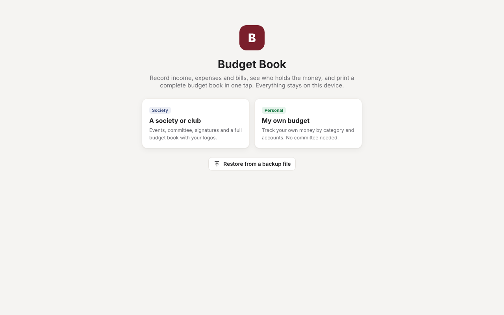

# Budget Book (v1)

Record a society's or your own income, expenses and bills, see who holds the money, and print a complete budget book PDF. Data stays on your device.

  

> A newer version with QR ticket sales is in **[budget-book-app_v_2](https://github.com/MeshanNawod/budget-book-app_v_2)**.

All data is stored **only on the device** (in the browser). There is no server and no account.

## Try it now (on a computer)
Open `index.html` in Chrome or Edge. Everything works, except "install as an app", which needs the online version below.

## Put it online for free (GitHub Pages): about 5 minutes
1. Make a free account at github.com and create a new **public** repository, for example `budget-book`.
2. Click **Add file → Upload files**, drag in everything from this folder (`index.html`, `sw.js`, `manifest.json`, the `icons` folder), and commit.
3. Go to **Settings → Pages**. Under "Branch" choose `main` and `/ (root)`, then **Save**.
4. After a minute your app is at `https://<your-username>.github.io/budget-book/`.

Each person who opens that link gets their **own private copy** of the data on their own device. Nobody else can see it.

## Install on a phone or computer
- **Android (Chrome):** open the link, then ⋮ menu → **Add to Home screen / Install app**.
- **iPhone (Safari):** open the link, then Share → **Add to Home Screen**.
- **Windows / Mac (Chrome or Edge):** click the install icon in the address bar.

After the first visit it also works **offline**.

## How to use
1. Choose **Society** or **Personal**.
2. In **Settings** add the name, university, year, contact line, the logos, the committee, and the three people who sign.
3. In **Accounts** set the opening balances. Make one bank account and one cash account for **each person who keeps cash**, so you always know who holds what. Use **Move money** when cash is withdrawn or handed over.
4. In **Events** add each event, with its Google Drive bills link if you have one. A QR code is printed for it.
5. Add each income or expense with **+**, and attach photos of the bills.
6. Open **Book** and tap **Generate PDF**, then download, print or share it.

## Backups and handover
Data lives in this browser only. Clearing the browser data, or losing the phone, loses it.
- Use **Settings → Save backup** often. It saves one `.json` file that includes the bill photos.
- To hand over to the next committee, send them that file. They open the app and choose **Restore backup**.
- **Settings → Start next year** carries the closing balances forward as the new opening balances.

## License

This project is licensed under the GNU General Public License v2.0 or later (GPL-2.0-or-later). See [LICENSE](LICENSE).
